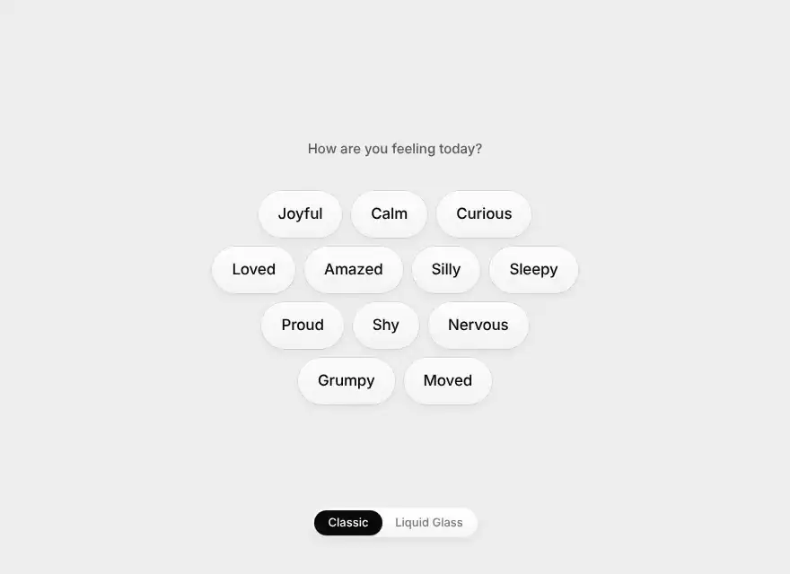

# Floating Preview Chips interaction

A loose cluster of mood chips. Hover one and a small tile floats up beside the cursor with that mood's emoji. Glide across the chips and the tile follows on a spring. It leans into the direction you move, and each emoji blurs out as the next one springs in. Click a chip to pick that mood. The tile pops when you pick one and dips when you clear it. Tab to a chip and its tile shows above it. Classic follows the system's light or dark mode. A switch at the bottom moves between Classic and Liquid Glass, where the tile turns to frosted glass over the chips.

<p align="center">
  
</p>

<p align="center"><a href="docs/demo.mp4">Watch as a video</a></p>

## Tech stack

- React 19
- Vite 8
- Tailwind CSS 4
- Pointer events driving a hand-rolled spring in `requestAnimationFrame` for the tile's position and lean, and CSS transitions on a spring `cubic-bezier` for the emoji swap and pop, no animation library
- `backdrop-filter` for the Liquid Glass tile, plus `matchMedia` hooks for system dark mode and `prefers-reduced-motion`

## Run

```bash
npm install
npm run dev
```
